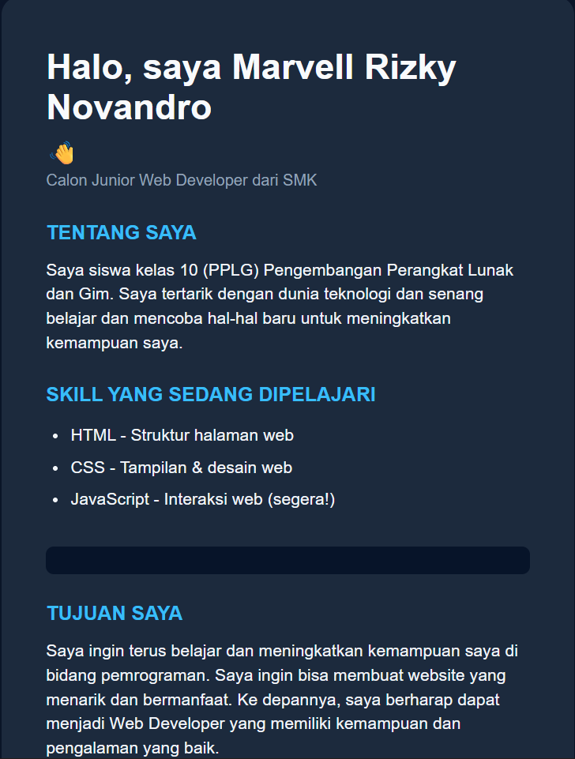

# Portofolio Marvell Rizky Novandro

Website portofolio pribadi yang dibuat sebagai bagian dari kegiatan **Kelas Industri UBIG (Paket 1, Minggu 01 sampai 09)**. Website ini digunakan untuk memperkenalkan profil diri, menampilkan keahlian, serta mendokumentasikan proyek-proyek yang telah dikerjakan selama proses belajar pemrograman web.

Website dirancang dengan tampilan responsif agar dapat diakses melalui berbagai perangkat, seperti ponsel, tablet, dan laptop.

## Tampilan Website



## Fitur Website

- **Beranda:** Menampilkan profil pribadi, hobi, cita-cita, dan keahlian.
- **Jadwal Belajar:** Menampilkan jadwal kegiatan belajar.
- **Halaman Proyek:** Menampilkan daftar proyek yang telah dibuat dalam bentuk kartu.
- **Halaman Kontak:** Menyediakan formulir untuk menghubungi pemilik website.
- **Desain Responsif:** Tampilan menyesuaikan ukuran layar perangkat menggunakan Flexbox dan Media Query.

## Teknologi yang Digunakan

- HTML5
- CSS3
- JavaScript
- Flexbox
- Media Query
- Git dan GitHub

## Struktur Folder

```text
tugas_rumah/
│
├── css/
│   └── style.css
│
├── data/
│   └── keahlian.json
│
├── html/
│
├── img/
│   ├── jadwal.png
│   ├── kalkulator.png
│   ├── logika.png
│   └── ...
│
├── js/
│   ├── logika.js
│   ├── main.js
│   └── script.js
│
├── index.html
├── baru.html
├── kalkulator.html
├── kontak.html
├── proyek.html
└── README.md
```

## Informasi Pembuat

**Nama:** Marvell Rizky Novandro

**Kelas:** X PPLG 1

**Program:** Kelas Industri UBIG

## Tautan

- **Website:** Belum tersedia
- **GitHub:** https://github.com/novandromarvel-cyber

---

Terima kasih telah mengunjungi repositori portofolio saya!!